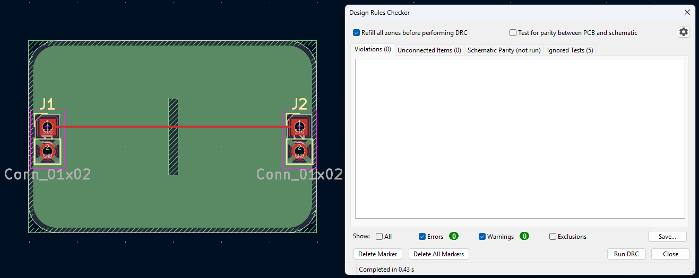
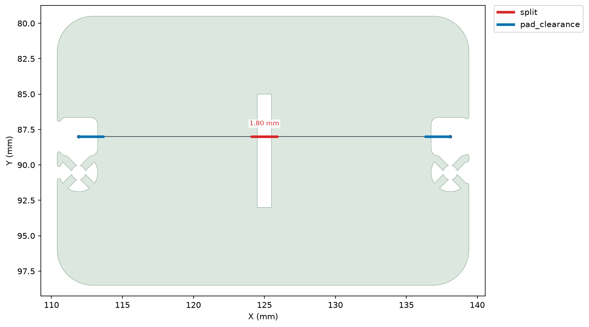
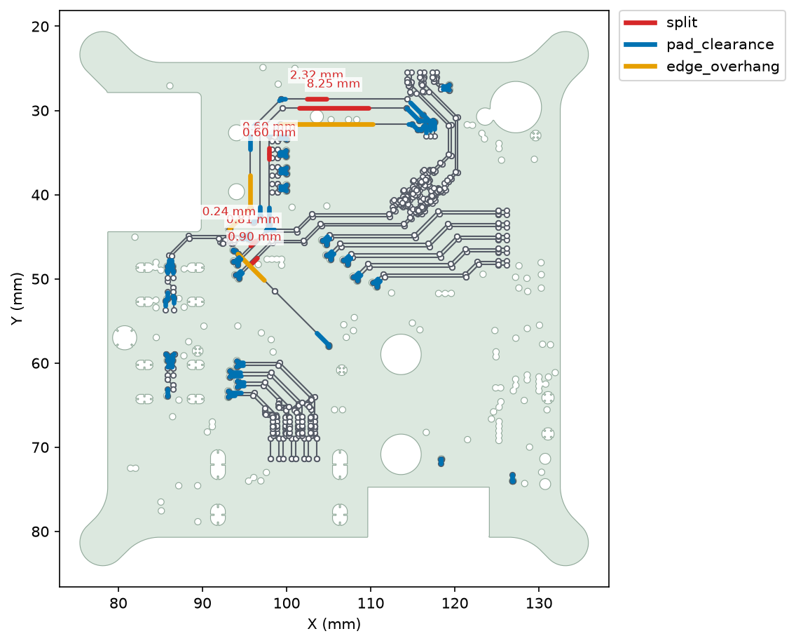

# kicad-tog: KiCad Trace-over-Gap Checker

[](https://github.com/trThanhnguyen/kicad-tog/actions/workflows/ci.yml)

A small, headless Python checker that flags signal traces routed over a gap in their
reference plane. Stable KiCad's DRC (10.0.x) does not catch this defect.

| KiCad 10: DRC passes the board (0 errors, 0 warnings) | kicad-tog: one split crossing, exit 1 |
|---|---|
|  |  |

The `split_crossed` fixture: a 1 mm slot in the In1.Cu GND plane under the SIG trace. The
slot leaves the plane in one piece, so the net stays connected and DRC has nothing to report.

## Why

**Fast edges make every board a high-frequency board.** What matters is the rise time,
not the clock rate. A 100 ps edge carries real energy up to about 0.35/RT ≈ 3.5 GHz,
even on a slow clock.

**At high frequency, the return current follows the trace.** Every signal current returns
through a reference plane: usually GND, sometimes a power plane. At high frequency the
return takes the path of lowest inductance, which is the strip of plane directly under
the trace. About 50% of it flows within ±h of the trace and about 80% within ±3h, where
h is the dielectric height.

**A gap forces a detour.** Sometimes the plane under the trace is cut: a split between
two pours, a slot, or a void left by routing on the plane layer. The return current then
has to go around the cut. The bigger loop adds series inductance right at the crossing.
The gap is short compared with the edge, so it acts as a lumped inductor, and its
impedance (jωL) grows with frequency: the faster the edge, the bigger the bump. The
result:
- **Reflections** at the impedance discontinuity.
- **Crosstalk**: nearby traces that cross the same gap share the detour.
- **EMI**: the enlarged loop and the slot radiate.

**Why KiCad.** KiCad is the leading open-source PCB tool, used from hobby boards to
open-hardware reference designs and, more and more, in industry. Its board files are
plain-text S-expressions, and `kicad-cli` runs headless, so a check can run in CI on
every commit. Commercial flows already check reference-plane continuity: Altium's
*Return Path* rule, Cadence Allegro's *Return Path* constraint, and Ansys SIwave's
*Net Crossing Split*. Stable KiCad does not. Its DRC checks clearance, width,
connectivity and similar rules, but none of them relates a trace to the plane beneath
it. A GND plane with a slot in it is still one connected net, so the board passes DRC.
Upstream KiCad is adding a similar rule for its next major release. Until then,
kicad-tog fills the gap for KiCad 10 users, and afterwards it can serve as a reference
to compare against the native rule.

## What

kicad-tog runs a **reference-plane continuity check**. For each critical net, it checks
that the trace, widened by a margin on each side, lies entirely over the filled copper
of its reference plane.

It is a *geometric* check, not a field solver. It finds **where** the return path
breaks, not **how much** that hurts: it gives no impedance, reflection or EMI numbers.

## Usage

Needs [pixi](https://pixi.sh). Python, Shapely and Matplotlib come from `pixi.toml`;
KiCad itself is not needed.

```sh
pixi install
pixi run test                                   # pytest

pixi run tog board.kicad_pcb                    # nets and planes found automatically
pixi run tog board.kicad_pcb --nets "/*USB*" --json out/usb.json --png out/usb.png
pixi run tog fixtures/split_crossed.kicad_pcb --nets SIG --ref In1.Cu   # manual mode, as in CI
```

| Option | Meaning |
|---|---|
| `--nets` | Comma-separated net names or KiCad-style wildcards. Default: see *Pick the nets* below |
| `--ref` | Check every trace against this one copper layer. Default: the nearest plane above and below each trace |
| `--layer` | Check only traces on this signal layer |
| `-k` | Margin factor, default 3 |
| `--json`, `--png` | Write a JSON report / a figure. In automatic mode, one figure per plane: `out.png` → `out_In1.Cu.png`, ... |

**Exit codes:** `0` no errors (warnings and info allowed), `1` at least one error, `2` the
check could not run (unreadable file, unknown net or layer, no nets selected, no stackup).
A check that could not run never passes as a clean board.

Refill the zones (KiCad: **B**) and save before running: kicad-tog reads the fills saved
in the file. In Windows Git Bash, net names that start with `/` get rewritten into paths;
run with `MSYS_NO_PATHCONV=1` or from PowerShell.

## How

1. **Parse** the `.kicad_pcb` file with its own S-expression parser (no pcbnew
   dependency). Read each net's tracks, the filled zone polygons on each layer, the
   stackup (dielectric heights) and the Edge.Cuts outline. KiCad 9 (numbered nets) and
   KiCad 10 (named nets) files both load.
2. **Pick the nets**, in this order:
   1. `--nets`, if given.
   2. Every net in a net class other than `Default`, from the `.kicad_pro` next to the
      board: the class patterns and the per-net assignments.
   3. Differential-pair names (`_P`/`_N`, `+`/`-`) when the project has no classes.
   4. Nothing found: exit 2. The report header says which rule picked the nets.
3. **Find the reference planes.** A *plane* is a copper layer whose fills (any net)
   cover at least 50% of the board area. KiCad's layer type doesn't help: on the demo
   boards every copper layer is declared `signal`, GND planes included. Each trace is
   checked against the nearest plane above and the nearest plane below it in the
   stackup, never against its own layer. `--ref` overrides this with one layer.
4. **Compute**, for each trace segment, the band radius `r = w/2 + k·h`. A point on the
   trace is safe only if a disc of radius r around it lies on reference copper. That is
   the same as lying inside the copper **eroded** by r, so:
   `uncovered = centreline − erode(reference copper, r)`.
   `k = 3` by default: the plane must extend at least 3h beyond each trace edge, which
   keeps about 80% of the high-frequency return current (J(x) ∝ 1/(1+(x/h)²)) over
   copper. Smaller k misses traces that hug plane edges; larger k flags most traces near
   pour boundaries.
   Each segment only gets the copper near it; a test checks that the results match
   the full-board version.
5. **Filter** out slivers shorter than 0.05 mm (numerical noise).
6. **Classify** each uncovered span:

   | Kind | Severity | Rule |
   |---|---|---|
   | `split` | error | the span touches neither end of the segment: the trace leaves the plane and comes back |
   | `pad_clearance` | info | the span touches a segment end and is shorter than 2.5 mm: the plane's clearance around the pad the trace starts from |
   | `edge_overhang` | warning | the span touches a segment end and is 2.5 mm or longer: the trace runs off the plane's edge |
   | `no_reference` | error | no plane above or below the trace |

   A gap in the nearest plane keeps this severity. A gap in the farther plane counts one
   level lower (error → warning). When both planes are equally near (h within 10%,
   a symmetric stripline), a gap in either is an error.
7. **Report** the net, layer, reference plane, location, length and kind, as text, JSON
   and a figure.

**What the length means.** The reported length is the **affected trace length**, not
the gap width. In `split_crossed`, the slot is 1.0 mm wide and h = 0.1 mm, so
r = 0.1 + 3 × 0.1 = 0.4 mm. Eroding the plane moves each edge of the slot back by 0.4 mm,
and the span runs from x = 124.1 to 125.9: **1.8 mm**. Along that stretch, part of the
trace's ±3h return band lies over the slot.

## Validation

- **Fixture boards with known answers**, in `fixtures/`. Native KiCad DRC passes all of
  them (0 errors, 0 warnings); kicad-tog must flag exactly the bad ones.

  All fixtures are the same 30 × 20 mm KiCad 10 board: two 2-pin headers (J1, J2) joined
  by one 0.2 mm trace, net `SIG`, on F.Cu. The stackup is KiCad's default 4 layers
  (F.Cu / In1.Cu / In2.Cu / B.Cu, 1.6 mm), and the reference plane is the GND zone on
  In1.Cu. So h = 0.1 mm (dielectric 1 only; copper thickness never counts) and
  k·h = 0.3 mm.

  | Fixture | GND plane under `SIG` | Result with `--nets SIG --ref In1.Cu` |
  |---|---|---|
  | `continuous` | Solid under the whole trace | 0 errors, 2 `pad_clearance` info; exit 0 |
  | `split_crossed` | Slotted: an 8 mm × 1 mm slot crosses under the trace; the plane stays one piece | 1 split, 1.80 mm (error), 2 info; exit 1 |
  | `edge_overhang` | Cut short: the plane ends about 13 mm before J2 (J2's ground reaches J1 through a B.Cu trace) | 1 edge overhang, 13.6 mm (warning), 1 info; exit 0 |

  In automatic mode, `edge_overhang`'s pour covers 43.6% of the board, so it is not a
  plane and the trace is reported as `no_reference`. A test pins this behaviour.

- **Unit tests:** pytest for the parser, loader, geometry, report and CLI.
- **CI:** GitHub Actions runs the tests on every push, then runs the checker on the three
  fixtures. `continuous` and `edge_overhang` must exit 0 and `split_crossed` exactly 1,
  so a crash (exit 2) can't pass as a detection. The text, JSON and PNG reports are
  uploaded as artifacts on every run, failing ones included.

### A real board



`pixi run tog CM5_MINIMA_3.kicad_pcb` with no flags, on the unedited board. The board
ships with KiCad 10 in `share/kicad/demos/cm5_minima/`: a Raspberry Pi CM5 carrier, 6
copper layers, 3.5 MB. kicad-tog picked 40 nets from the project's net classes
(`90ohm`, `100ohm`), found In1–In4 and B.Cu as planes, and checked every trace against
its nearest planes in about 12 s on a laptop. The figure shows the In1.Cu reference.

This run shows that the tool **loads and runs on a real multi-layer board**. It is not
a verified list of defects: arc tracks are skipped and gaps under bends are misread
(see *Limits*). Two things are visible in the figure:
- The three F.Cu errors (0.24, 0.81 and 0.90 mm, left of centre) fall on the round
  clearance holes (antipads) of nearby vias, not on plane splits. Telling a small round
  hole from a real slot is the next feature.
- The project's pattern `/*PCIE*` also puts slow sideband lines (`PWR_EN`, `nRST`,
  `nWAKE`) into the 90 Ω class, so they are checked too.

Board: CM5 MINIMA REV3, from KiCad's demos, licensed CERN-OHL-S-2.0.

## Limits

- Geometry only; nothing about electrical severity.
- **Arc tracks are not read yet**: bends routed as arcs are not checked.
- **Spans are classified per segment, not per track.** A gap under a bend between two
  segments touches both segment ends, so it reads as two `pad_clearance` infos instead
  of one split. A gap exactly at a T-junction splits the same way.
- Antipads count as gaps when they reach into the band; stitching vias and capacitors
  bridging a split are not considered.
- The board area for the 50% rule is the bounding box of the Edge.Cuts outline, which
  understates coverage on non-rectangular boards. A plane that covers less than half the
  board (like `edge_overhang`'s) needs `--ref`.
- The check uses the fills saved in the file: refill and save first.
- Automatic mode needs the board's stackup; without one it exits 2.
- Net selection trusts the project's net classes, broad patterns included.
